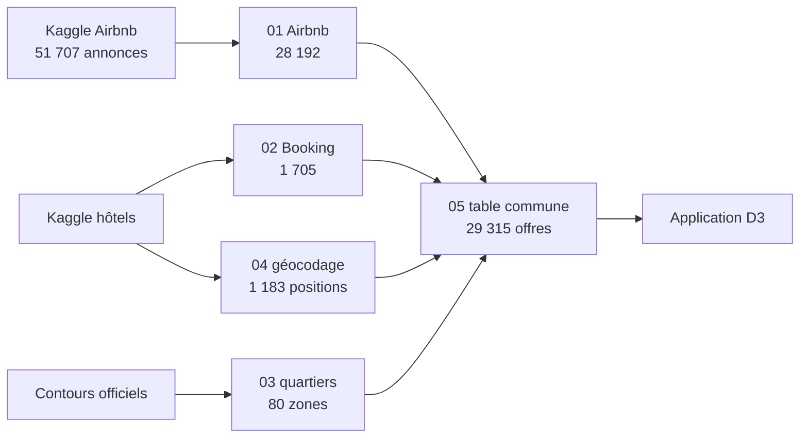

# Workflow des données

Les données suivent le modèle du cours : données brutes, transformation, table commune, puis visualisation. Toute la chaîne se rejoue avec `./scripts/build_data.sh`.

| Script | Ce qu'il fait | Sortie |
|---|---|---|
| `scripts/download_data.sh` | Télécharge les deux datasets Kaggle par l'API publique. | `data/raw/` |
| `scripts/download_geo.sh` | Télécharge les contours des quartiers des quatre villes. | `data/raw/geo/` |
| `notebooks/01_airbnb.ipynb` | Garde les 4 villes communes, calcule le prix par nuit (`realSum / 2`) et recalcule la distance depuis le centre de Booking. | 28 192 annonces |
| `notebooks/02_hotels_booking.ipynb` | Aplatit le JSON, retire 3 doublons, convertit les dollars en euros, ramène la note sur 100 et signale Rome. | 1 705 hôtels |
| `notebooks/03_quartiers.ipynb` | Met les contours au même format et relie chaque nom de quartier Booking à un contour officiel. | 80 quartiers |
| `notebooks/04_geocodage_hotels.ipynb` | Retrouve la position des hôtels dans OpenStreetMap et ne garde que celles qui passent trois contrôles. | 1 183 positions |
| `notebooks/05_table_commune.ipynb` | Fusionne les deux sources, rattache chaque offre à un quartier, retire 582 prix aberrants et valide le schéma. | `offres.csv` : 29 315 offres, 19 colonnes |

La logique réutilisable est dans `src/prep/`. Le module `schema.py` est le contrat de la table : chaque étape le vérifie avant d'écrire. L'application charge directement `offres_<ville>.csv` et `quartiers_<ville>.geojson`.
