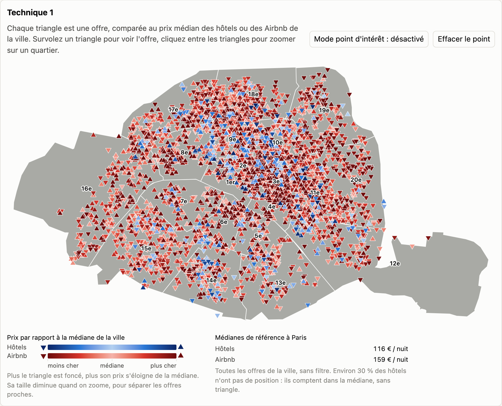

# Technique 1 : la carte des offres

Chaque offre qui a une position devient un triangle sur la carte des quartiers. Le triangle ne montre pas le prix lui-même, mais sa place par rapport au prix habituel de sa source dans la ville : la médiane des hôtels pour un hôtel, celle des Airbnb pour un Airbnb.

## Données et variables visuelles

| Donnée | Variable visuelle | À quoi elle sert |
|---|---|---|
| `lat`, `lon` | position, projection de Mercator | situer l'offre dans la ville (T3) |
| `prix_nuit_eur` comparé à la médiane | orientation : ▲ plus cher, ▼ moins cher | voir d'un coup d'œil où l'on paie plus ou moins que d'habitude (T1, T3) |
| écart à la médiane | luminosité, de clair à foncé, maximale à ×2 ou ÷2 | repérer les offres très chères ou très bon marché |
| `source` | teinte : bleu pour les hôtels, rouge pour les Airbnb | distinguer les deux offres |
| `quartier` et ses contours | aires sur fond gris neutre, étiquettes | se repérer et zoomer sur un quartier, sans orienter la lecture |
| toutes les colonnes | infobulle au survol, fiche au clic | détails à la demande (T6) |

La taille du triangle ne code pas de donnée : elle diminue quand on zoome, pour séparer les offres proches, et grandit pour l'offre sélectionnée.

## Interactions

- Un clic entre les triangles zoome sur le quartier : c'est le zoom sémantique du cours.
- Le survol et le clic d'une offre la surlignent aussi dans le nuage de points.
- Les filtres et le changement de ville agissent sur les triangles affichés.
- Les points d'intérêt (technique 2) se posent sur cette carte.

La médiane est calculée sur toute la ville, sans filtre : la référence ne bouge pas quand on filtre.
