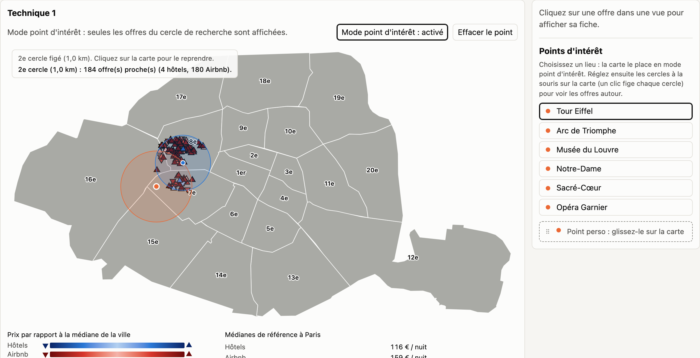

# Technique 2 : les points d'intérêt

Le voyageur part souvent d'un lieu à visiter. Il choisit un monument dans le panneau de droite, ou glisse un point perso sur la carte, qui ne garde alors que les offres autour et les compte par source.

## Données et variables visuelles

| Donnée | Variable visuelle | À quoi elle sert |
|---|---|---|
| position du lieu | repère orange sur la carte | situer le monument choisi (T5) |
| distance au lieu, choisie à la souris | rayon du 1er cercle, en orange | fixer à quelle distance du lieu on accepte de loger |
| zone de recherche | 2e cercle, en bleu, centré sur le 1er | délimiter le secteur où l'on cherche, dans la direction choisie |
| `lat`, `lon` des offres | seules les offres du cercle restent affichées, avec un contour foncé | voir ce qui est vraiment accessible depuis le lieu |
| `source` des offres retenues | encart : nombre d'hôtels et d'Airbnb | comparer les deux offres autour du lieu (T1, T5) |

Les distances sont à vol d'oiseau. Les triangles gardent leur encodage de la carte.

## Lieux prédéfinis

Six lieux par ville, placés avec les coordonnées des registres officiels du patrimoine : bases Mérimée et Muséofile à Paris, Denkmaldatenbank à Berlin, Historic England à Londres. À Rome, faute de registre accessible, elles viennent d'OpenStreetMap.

## Interactions

- Un clic sur un lieu le place et active le mode point d'intérêt.
- Le point perso se glisse depuis le panneau et ne se dépose que sur la carte.
- Un clic fige le 1er cercle, un autre fige le 2e ; le repère se déplace à la souris.
- Une offre retenue reste survolable et cliquable, et se surligne dans le nuage de points.
