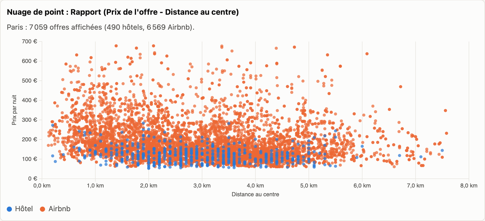

# Technique 3 : le nuage de points

Chaque offre est un point placé selon sa distance au centre et son prix par nuit. Le nuage répond à la question du compromis : que gagne-t-on à s'éloigner du centre, et la réponse est-elle la même pour un hôtel et pour un Airbnb ?

## Données et variables visuelles

| Donnée | Type | Variable visuelle | À quoi elle sert |
|---|---|---|---|
| `dist_centre_km` | quantitatif | position horizontale, échelle linéaire en km | voir l'effet de l'éloignement sur le prix (T2) |
| `prix_nuit_eur` | quantitatif | position verticale, échelle linéaire en euros | comparer les prix des offres (T1) |
| `source` | catégoriel | teinte : bleu pour les hôtels, orange pour les Airbnb | comparer les deux nuages entre eux |
| aucune | — | taille et opacité constantes, points semi-transparents | la superposition fait apparaître les zones denses |
| toutes les colonnes | tous | infobulle au survol, fiche au clic | détails à la demande (T6) |

La position est la variable visuelle la plus précise : elle est réservée aux deux grandeurs que l'utilisateur veut comparer. La couleur ne sert qu'à séparer les deux sources, avec la même paire bleu et orange que dans le reste de l'interface.

## Interactions

- Le survol et le clic d'un point surlignent la même offre sur la carte (brushing & linking), et le clic ouvre sa fiche.
- Les filtres communs s'appliquent ; avec le filtre de distance, l'axe horizontal s'arrête à la distance choisie.
- En mode point d'intérêt, l'axe horizontal mesure la distance au point choisi sur la carte, et seules les offres du 2e cercle restent affichées.
- Un résumé au-dessus du graphique compte les offres affichées par source.

À Rome, les prix des hôtels ne sont pas comparables à ceux des Airbnb : le nuage de Rome se lit avec prudence.
