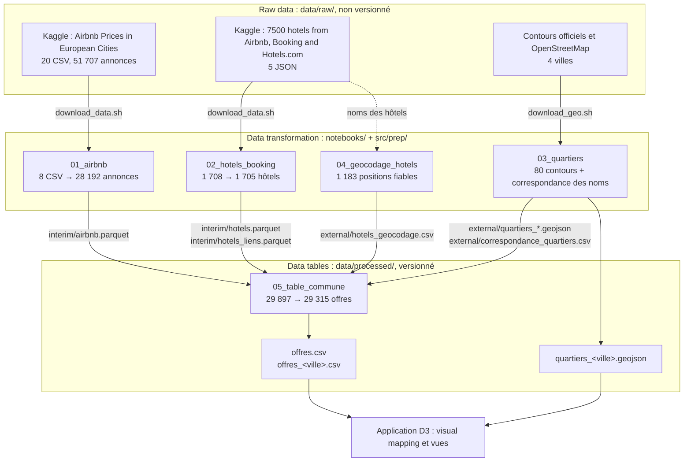

# Workflow de préparation des données

Ce document suit les données depuis les fichiers Kaggle bruts jusqu'au dataset chargé par D3. Pour chaque étape, il indique quel script s'exécute, ce qu'il lit, ce qu'il fait et ce qu'il produit, avec le nombre de lignes. Les choix de nettoyage sont justifiés dans `docs/decisions.md` (références D1 à D19), et les colonnes de la table finale sont décrites dans `docs/schema.md`.

## 1. Vue d'ensemble

Le découpage suit le modèle de pipeline du cours (Ward, Grinstein et Keim) : *Raw data → Data transformation → Data tables → Visual mapping → Views*. Ce document couvre les trois premières étapes. Les deux dernières relèvent de l'application D3.



| Étape du modèle | Script | Entrée | Sortie | Lignes |
|---|---|---|---|---|
| Raw data | `scripts/download_data.sh` | API Kaggle | `data/raw/airbnb/`, `data/raw/hotels/` | 51 707 annonces, 5 JSON |
| Raw data | `scripts/download_geo.sh` | 4 services de contours | `data/raw/geo/` | 4 fichiers |
| Data transformation | `notebooks/01_airbnb.ipynb` | 8 CSV | `data/interim/airbnb.parquet` | 28 192 |
| Data transformation | `notebooks/02_hotels_booking.ipynb` | 4 JSON | `data/interim/hotels.parquet` | 1 705 |
| Data transformation | `notebooks/03_quartiers.ipynb` | contours bruts | `data/external/quartiers_*.geojson`, `data/processed/quartiers_*.geojson` | 80 zones |
| Data transformation | `notebooks/04_geocodage_hotels.ipynb` | 4 JSON, OSM, Nominatim | `data/external/hotels_geocodage.csv` | 1 705, dont 1 183 fiables |
| Data tables | `notebooks/05_table_commune.ipynb` | tout ce qui précède | `data/processed/offres*.csv` | 29 315 |

Toute la chaîne se rejoue avec une seule commande : `./scripts/build_data.sh`. Elle télécharge ce qui manque, puis exécute les notebooks dans l'ordre. Le notebook 04 n'est rejoué qu'avec `GEOCODER=1`, parce qu'il interroge des services en ligne pendant environ 15 minutes. Son résultat est versionné.

### Organisation du code

Les notebooks explorent les données, montrent les constats et justifient les choix. La logique réutilisable est dans `src/prep/`, que les notebooks importent :

| Module | Rôle |
|---|---|
| `src/prep/common.py` | Constantes partagées : villes, taux USD → EUR, seuil du métro, tranches de distance, centres de référence ; calcul des distances et des identifiants. |
| `src/prep/schema.py` | **Le contrat de la table commune** : liste des colonnes, types, valeurs autorisées. `valider()` refuse toute table qui ne le respecte pas. Chaque étape l'appelle avant d'écrire. |
| `src/prep/airbnb.py` | Chargement et transformation des CSV Airbnb. |
| `src/prep/hotels.py` | Chargement et transformation du JSON Booking. |
| `src/prep/quartiers.py` | Contours des quartiers, jointure spatiale, export pour D3. |
| `src/prep/geocodage.py` | Recherche des positions des hôtels (OSM, Nominatim) et contrôles de qualité. |
| `src/prep/fusion.py` | Fusion des sources, rattachement aux quartiers, retrait des aberrants, contrôles et export CSV. |

## 2. Étape 0 : récupérer les données brutes

### `scripts/download_data.sh`

- **Fait** : télécharge les deux datasets Kaggle par l'API publique (`https://www.kaggle.com/api/v1/datasets/download/<auteur>/<dataset>`), sans jeton d'authentification, puis les décompresse.
- **Produit** :
  - `data/raw/airbnb/` : 20 CSV (10 villes × semaine / week-end), 51 707 annonces ;
  - `data/raw/hotels/` : 5 JSON (Londres, Berlin, Paris, Rome, Madrid). Chaque JSON contient trois listes : `bookingHotels` (500 par ville, 208 à Rome), `hotelsComHotels` (500) et `airbnbHotels` (270).
- Les données brutes ne sont **pas versionnées** (`.gitignore`) : le script suffit à les retrouver. Les deux datasets sont sous licence CC0 (`docs/sources.md`).

### `scripts/download_geo.sh`

- **Fait** : télécharge les contours des quartiers de chaque ville.
- **Produit** dans `data/raw/geo/` :
  - les 20 arrondissements de Paris (Ville de Paris, GeoJSON) ;
  - les 12 Bezirke de Berlin (Geoportal Berlin, service WFS) ;
  - les 33 boroughs de Londres (ONS Open Geography Portal, GeoJSON) ;
  - les 15 municipi de Rome (OpenStreetMap, via Overpass).

## 3. Étape 1 : transformer les annonces Airbnb

### `notebooks/01_airbnb.ipynb` (module `src/prep/airbnb.py`)

- **Lit** : les 8 CSV des 4 villes communes aux deux datasets (`london`, `berlin`, `paris`, `rome`, × `weekdays` / `weekends`). Madrid n'existe pas côté Airbnb, et les 6 autres villes n'existent pas côté hôtels (D1).
- **Explore** : types de colonnes, valeurs manquantes (aucune), distributions du prix, de la note et des distances, types de logement, doublons (aucun strictement identique).
- **Fait** :
  1. ajoute la ville et la période (`semaine` / `weekend`), tirées du nom de fichier ;
  2. calcule le **prix par nuit** : `realSum / 2`, puisque `realSum` est le prix total pour 2 personnes et 2 nuits (D3) ;
  3. garde la note `guest_satisfaction_overall`, déjà sur 100 (D9) ;
  4. dérive le booléen `metro_proche` : station à moins de 500 m (D8) ;
  5. **recalcule la distance au centre** depuis le même point que Booking. Le notebook montre que la distance d'origine part d'Alexanderplatz à Berlin et de la gare Termini à Rome, au lieu de la porte de Brandebourg et de la piazza Venezia (D18) ;
  6. range chaque annonce dans une tranche de distance : 0–1, 1–2, 2–4, > 4 km (D14) ;
  7. traduit les types de logement : logement entier, chambre privée, chambre partagée ;
  8. génère un identifiant stable (`PAR-A-00001`…) et valide le schéma.
- **Produit** : `data/interim/airbnb.parquet`, **28 192 annonces** au schéma commun.

| Ville | Semaine | Week-end | Total |
|---|---|---|---|
| Londres | 4 614 | 5 379 | 9 993 |
| Berlin | 1 284 | 1 200 | 2 484 |
| Paris | 3 130 | 3 558 | 6 688 |
| Rome | 4 492 | 4 535 | 9 027 |

## 4. Étape 2 : transformer les hôtels Booking

### `notebooks/02_hotels_booking.ipynb` (module `src/prep/hotels.py`)

- **Lit** : les JSON de Londres, Berlin, Paris et Rome.
- **Explore** et **décide** :
  - **seule la liste Booking est gardée** : Hotels.com n'a ni quartier, ni distance, ni métro, ni étoiles (D2) ;
  - le prix Booking est un **prix par nuit** : ses médianes sont proches de celles de Hotels.com (D4) ;
  - **Rome est une anomalie** : prix 2 à 5 fois plus élevés à étoiles égales. Les hôtels de Rome sont gardés, mais marqués `prix_comparable = false` (D7) ;
  - le champ des taxes est absent pour 95 % des hôtels de Londres : on garde le prix affiché seul (D4) ;
  - les distances ≥ 100 sont des mètres lus comme des kilomètres (D6).
- **Fait** :
  1. aplatit la liste `bookingHotels` du JSON en table : **1 708 hôtels** ;
  2. retire 3 doublons, repérés par leur lien Booking : **1 705 hôtels** (D12) ;
  3. convertit le prix en euros : 1 € = 1,0813 $, moyenne BCE 2023 (D5) ;
  4. ramène la note sur 100 (score × 10) ; « No rating » devient vide (D9) ;
  5. corrige les distances en mètres et calcule la tranche de distance ;
  6. repère les 134 logements entiers proposés sur Booking (D11) ;
  7. normalise le nom de quartier : « 7th arr., Paris » devient « 7e arrondissement » (D15) ;
  8. génère l'identifiant (`PAR-H-00001`…) et valide le schéma.
- **Produit** :
  - `data/interim/hotels.parquet` : 1 705 hôtels au schéma commun ;
  - `data/interim/hotels_liens.parquet` : la correspondance identifiant → lien Booking, qui sert de clé pour le géocodage.

## 5. Étape 3 : construire le référentiel de quartiers

### `notebooks/03_quartiers.ipynb` (module `src/prep/quartiers.py`)

- **Lit** : les contours bruts de `data/raw/geo/`.
- **Fait** :
  1. ramène les 4 villes au même format (`ville`, `quartier`, `code`) et en coordonnées WGS84. Londres est reprojeté depuis le système britannique, et les municipi de Rome sont reconstitués à partir des chemins OpenStreetMap (D16) ;
  2. vérifie la table de correspondance `data/external/correspondance_quartiers.csv`, écrite à la main. Elle associe les 85 noms de quartier Booking à un contour : nom identique, quartier contenu dans le contour (Chiswick → Hounslow, Trevi → Municipio I), ou approximation (D17) ;
  3. rattache les annonces Airbnb par jointure spatiale (point dans le polygone) : 28 187 sur 28 192 tombent dans un contour, et les 5 autres, en bordure de Rome, sont à moins de 250 m (D17) ;
  4. mesure où la comparaison est possible : zones avec au moins 30 Airbnb et 10 hôtels (D16) ;
  5. simplifie les contours (tolérance 25 m) et oriente les polygones comme l'attend `d3.geoPath`.
- **Produit** :
  - `data/external/quartiers_<ville>.geojson` : contours en pleine précision, utilisés pour les jointures ;
  - `data/processed/quartiers_<ville>.geojson` : contours allégés pour D3, de 10 à 103 Ko.

## 6. Étape 4 : géolocaliser les hôtels

### `notebooks/04_geocodage_hotels.ipynb` (module `src/prep/geocodage.py`)

- **Pourquoi** : le dataset Booking ne donne pas de coordonnées. Sans elles, les hôtels ne peuvent pas être placés sur une carte, ni rattachés à un quartier aussi précisément que les Airbnb.
- **Lit** : les noms des 1 705 hôtels, leur quartier Booking et leur distance au centre.
- **Fait** :
  1. cherche chaque hôtel dans OpenStreetMap (Overpass) en comparant les noms (similarité floue) : 1 036 positions fiables ;
  2. interroge Nominatim pour les hôtels restants : 93 de plus ;
  3. intègre les corrections relues à la main (`data/external/hotels_geocodage_corrections.csv`, 95 lignes) : 54 de plus ;
  4. contrôle chaque position :
     - elle est dans l'emprise de la ville ;
     - elle est cohérente avec la distance Booking : écart de 0,5 km au plus ;
     - elle tombe dans le quartier annoncé ;
  5. estime au passage le « centre » d'où Booking mesure ses distances (G1).
- **N'a pas fait** : extraire les pages Booking, ce que les conditions d'utilisation du site interdisent (G4).
- **Produit** : `data/external/hotels_geocodage.csv`. Il contient une ligne par hôtel, avec la position, la méthode, le score de similarité, les contrôles et le statut `fiable`. **1 183 positions sont fiables sur 1 705 (69 %)** (D19).

## 7. Étape 5 : construire la table commune

### `notebooks/05_table_commune.ipynb` (module `src/prep/fusion.py`)

- **Lit** : les deux tables intermédiaires, les contours, la correspondance des noms et le géocodage.
- **Fait** :
  1. **fusionne** Airbnb et hôtels en une seule table, une ligne par offre : **29 897 lignes** ;
  2. ajoute la position des hôtels dont le géocodage est fiable ;
  3. **rattache chaque offre à un quartier** du référentiel commun : par la position si elle existe (tous les Airbnb, 1 183 hôtels), sinon par le nom Booking. Quand les deux méthodes sont possibles, elles s'accordent dans 98 à 99 % des cas (D17) ;
  4. **retire les prix aberrants**, hors des percentiles 1–99 % calculés par ville et par source : 582 lignes, soit 1,9 % (D13) ;
  5. exécute les **contrôles qualité** :
     - effectifs avant et après nettoyage ;
     - valeurs manquantes par source ;
     - distributions des prix et des notes ;
     - cohérence des distances entre sources ;
     - couverture des quartiers ;
  6. **exporte** les fichiers lus par D3.
- **Produit** :
  - `data/processed/offres.csv` : **29 315 offres**, 19 colonnes, 3,9 Mo ;
  - `data/processed/offres_<ville>.csv` : une ville par fichier, pour la consigne « changer de dataset ».

| Ville | Airbnb | Hôtels | dont hôtels géolocalisés |
|---|---|---|---|
| Londres | 9 795 | 490 | 336 |
| Berlin | 2 434 | 491 | 356 |
| Paris | 6 569 | 490 | 335 |
| Rome | 8 845 | 201 | 139 |
| **Total** | **27 643** | **1 672** | **1 166** |

## 8. Le dataset à visualiser

La table finale `offres.csv` contient une ligne par hébergement. Ses colonnes relèvent de plusieurs types de données (Munzner) :

| Type de donnée | Colonnes |
|---|---|
| Catégorielle | `ville`, `source`, `type`, `quartier`, `periode` |
| Ordinale | `etoiles`, `tranche_dist` |
| Quantitative | `prix_nuit_eur`, `note_100`, `nb_avis`, `dist_centre_km`, `capacite` |
| Booléenne | `metro_proche`, `superhost`, `prix_comparable` |
| Spatiale | `lat`, `lon` (points) ; `quartier` relié aux polygones de `quartiers_<ville>.geojson` |
| Identifiant | `id`, `nom` |

C'est un dataset **multivarié**, avec 19 attributs pour 29 315 objets, dont une dimension spatiale. Le dictionnaire complet est dans `docs/schema.md`.

Côté D3, les fichiers se chargent tels quels :

```js
const offres = await d3.csv("data/processed/offres_paris.csv", d3.autoType);   // nombres et booléens convertis
const zones  = await d3.json("data/processed/quartiers_paris.geojson");       // relier par offre.quartier = feature.properties.quartier
```
